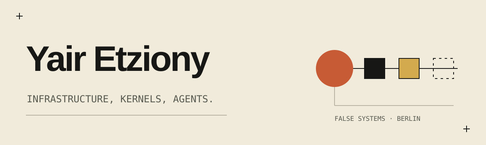
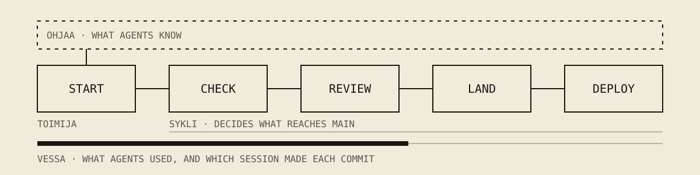

I got interested in networks, went off to study history and philosophy, and somehow ended up spending 30 years working with infrastructure. These subjects have started to converge.

I'm interested in what sits underneath the abstractions: Linux kernels, execution, isolation, authority, and evidence. Especially now that the thing operating a computer isn't necessarily a person.

I founded [False Systems](https://false-systems.com) to explore some of these problems. I like systems whose behaviour can be examined independently, and tools that are reasonably clear about what they cannot do.

## Tools for working with coding agents

Most of my code is now written with agents. These are the four small tools I use to do that every day, open and MIT licensed. Each works alone; together they take a change from an agent's first prompt to main, checked and reviewed by a second agent.

| Tool | What it does |
|---|---|
| **[toimija](https://github.com/false-systems/toimija)** | Starts a coding agent with the facts of the repository, and shows who is working where. |
| **[sykli](https://github.com/false-systems/sykli)** | Runs the checks you declare and keeps proof. A second agent reviews the change before it reaches main. |
| **[ohjaa](https://github.com/false-systems/ohjaa)** | Holds what your agents are told: decisions, lessons, facts. Anyone proposes; a person decides. |
| **[vessa](https://github.com/false-systems/vessa)** | Counts what your agents used, from the records they leave on disk. |

Start with [Your first loop](https://github.com/false-systems/toimija/blob/main/docs/first-loop.md): one change, through all four.

## Linux and the kernel

- **[Syvä](https://github.com/false-systems/syva)**: workload confinement through eBPF and BPF-LSM, without replacing the container runtime.
- **[Tapio](https://github.com/false-systems/tapio)**: turning selected Linux kernel failures into structured evidence.

There's also a research project asking a more fundamental question: what would it take for Linux to have coherent, first-class security domains? Identity, file-descriptor authority, inheritance, revocation, and the uncomfortable gaps between existing mechanisms.

Some of this work is practical engineering. Some of it is research. Occasionally the research explains why the practical engineering is harder than expected.

## Language models

- **[Vaisto](https://github.com/yairfalse/vaisto)**: typed operations and pipelines for working with language models, meant to outlive the models that run them.

## Sound

I compose music and build some of the instruments I play it with: [Endurance](https://github.com/yairfalse/endurance), a polymetric sequencer and sampler; [Inversion](https://github.com/yairfalse/inversion), a granular sampler of disintegrating tape loops; [Radiance](https://github.com/yairfalse/radiance), a dub chord machine; and [Enforcement](https://github.com/yairfalse/enforcement), a dub techno processing chain.

## Elsewhere

I'm a Claude Ambassador, chair the CD Foundation Ambassador cohort, and help organize infrastructure and open-source communities in Berlin. I remain interested in the history of technology, and have a particular affection for old operating systems.

**I build my own containers because I can.**

[false-systems.com](https://false-systems.com) · Berlin · computing as craft
